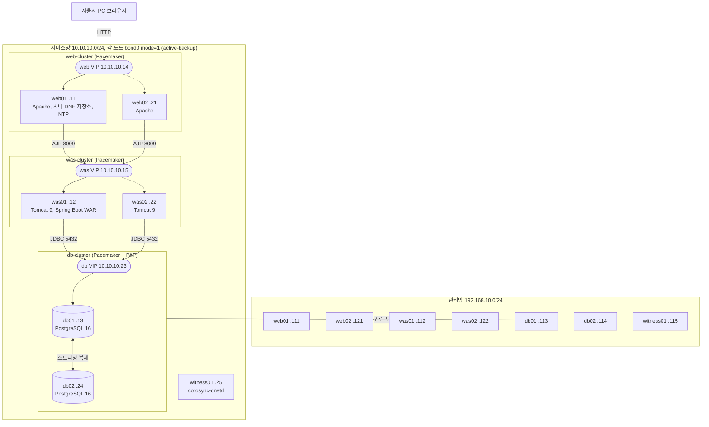

# 3tier-postgresql-ha

Rocky Linux 10 위에 Apache, Tomcat, PostgreSQL 16 3계층을 폐쇄망으로 혼자 구축하고 복제, 장애 전환, 복구를 직접 검증한 기록이다. 교육과정 중 따로 진행한 개인 프로젝트다.

## 구성도

점선은 평소 대기 쪽이다. witness01은 서비스망 주소(.25)를 갖지만, qdevice 투표 경로는 링과 분리하려고 관리망으로 두었다.

## 단계별로 한 것

### Phase 1: 3계층 기본 구축
- Vagrant로 web01, was01, db01을 만들고, 서비스망 NIC 2장을 nmcli로 bond0(mode=1)로 묶었다.
- web01에 Apache와 mod_proxy_ajp, 폐쇄망용 사내 DNF 저장소, NTP 서버(chrony)를 두었다.
- was01에 Tomcat 9(RPM)과 AJP 커넥터를 열고 Spring Boot WAR를 배포했다. AJP 포트는 web01에서만 허용했다.
- db01에 LVM으로 /pgdata, /pgwal, /pgbackup을 나누고 PostgreSQL 16을 /pgdata에 초기화했다. SELinux 컨텍스트를 지정하고 WAL 아카이빙을 켰다.

### Phase 2: web, was 이중화
- web02, was02를 추가하고 Pacemaker 클러스터를 만들었다.
- web VIP(10.10.10.14), was VIP(10.10.10.15)를 등록하고 httpd, tomcat을 Pacemaker 리소스로 옮긴 뒤 콜로케이션과 순서 제약을 걸었다.
- AJP 대상을 was VIP로 바꾸고, web01과 was01을 강제로 멈춰 서비스가 web02, was02로 넘어가는지 시험했다.

### DB 복제와 복구
- db02를 db01의 Standby로 붙였다. 복제 전용 계정, pg_hba, `pg_basebackup`, 복제 슬롯을 썼다.
- db01을 내리고 db02를 `pg_promote()` 로 승격하는 수동 페일오버를 연습했다.
- db01을 `pg_basebackup` 으로 db02 아래 새 Standby로 되돌리고 양쪽에 `wal_log_hints=on` 을 적용했다.
- WAL 미포함 베이스 백업과 아카이브만으로 DROP TABLE 직전 시점을 되살리는 PITR 드릴을 했다.
- `pg_dump` 와 `pg_dumpall --globals-only` 논리 백업을 systemd timer로 매일 자동 실행하게 했고, 7일 지난 백업은 지운다.

### DB 자동 전환
- db01, db02로 별도 db-cluster를 만들고 PAF(`ocf:heartbeat:pgsqlms`)와 db VIP(10.10.10.23)를 올렸다.
- witness01을 추가해 corosync-qdevice로 쿼럼을 맞췄다. 펜싱 장치가 없어 `stonith-enabled=false` 와 `no-quorum-policy=demote` 를 썼다.
- was01, was02의 접속 주소를 db VIP로 바꿨다.
- 논리 백업을 역할 인식형으로 고쳐 두 노드에 같이 배포했다. Primary인 쪽에서만 실제로 백업한다.

## 장애와 해결

### 1. WAL 아카이빙이 오류 없이 조용히 실패했다 (§12)
- 증상: Phase 1부터 `archive_mode=on` 이었는데 아카이브가 한 번도 쌓이지 않았다. db02를 승격할 때 타임라인 `.history` 파일을 아카이브하다 `Permission denied` 가 나서야 알았다.
- 원인: `/pgwal` 디렉터리 소유자가 `root:root` 여서 postgres가 쓸 수 없었다.
- 해결: §6-4의 `chown` 에 `/pgwal` 을 넣어 처음부터 고쳤고, §14 PITR 드릴로 그 아카이브로 실제 복구가 되는지까지 확인했다.

### 2. web01과 web02의 IP 중복이 한쪽 방향 통신 장애를 만들었다 (v16)
- 증상: web02, was02에서 web01, was01 방향으로만 통신이 안 됐다. ARP, 방화벽, 커널 파라미터를 의심했지만 모두 원인이 아니었다.
- 원인: 이전 판 가이드가 web01 bond0에도 10.10.10.21을 두 번째 주소로 주게 했는데, 같은 주소를 Phase 2에서 web02 노드 IP로 썼다. web01에서 10.10.10.21로 보낸 ping이 비정상적으로 빨랐던 것이 단서였다.
- 해결: web01, was01의 두 번째 주소를 없애고 서비스망 주소 정리표를 만들었다. bond0 설정 블록은 호스트명으로 IP를 스스로 고르게 바꿨다.

### 3. Pacemaker 전환 뒤 저장소가 멈춰 dnf가 실패했다 (§10~§11)
- 증상: db02에서 `dnf install` 이 `local-web01` 저장소 메타데이터를 받지 못해 실패했다.
- 원인: 저장소 서버를 겸하던 web01의 Apache를 Pacemaker 관리로 넘기며 `systemctl disable` 했기 때문에, 리소스가 web02로 넘어가 있는 동안 web01 Apache와 저장소가 같이 꺼져 있었다.
- 해결: web 리소스를 web01로 되돌리고 저장소 응답(`200 OK`)을 확인한 뒤 설치했다. 이후 작업은 web 리소스를 web01에 둔 채 진행한다. 저장소를 클러스터 관리 밖으로 분리하는 근본 해결은 적용하지 않았다.

### 4. DB 자동 전환이 실패했다 (CP7, §16)
- 증상: Primary를 하드 poweroff했지만 Standby가 자동으로 승격되지 않았다.
- 원인: bond0 flapping으로 생긴 짧은 corosync 파티션이 가짜 승격과 강등을 일으켰고, 그 뒤 살아남은 노드의 승격 점수가 음수로 굳었다. Primary가 죽은 뒤에는 점수를 다시 매겨 줄 노드가 없었다.
- 해결: `crm_attribute --update` 로 점수를 다시 주어 승격시키고, 데이터 손실이 없는지 WAL로 확인했다. 재발을 줄이려고 corosync token을 3000ms에서 10000ms로 올리고, 게스트 clocksource를 acpi_pm에서 tsc로 바꿨다.
- 남은 한계: 흔들림이 멤버십 변경으로 번지는 일은 줄었지만, Primary가 갑자기 죽으면 수동 개입 1회가 필요할 수 있다.

## 검증 결과

가이드에 적힌 결과만 옮겼다.

| 항목 | 결과 |
|---|---|
| Phase 1 End-to-End | db01 로컬 조회부터 호스트 PC 외부 curl까지 5단계 모두 `DB 연결 성공: appdb`, `StatusCode 200` |
| Phase 2 페일오버 | web01, was01을 `pcs cluster stop` 으로 멈췄을 때 VIP와 서비스가 web02, was02로 넘어가고 `DB 연결 성공: appdb` 유지 |
| 스트리밍 복제 | `pg_stat_replication` 에서 `streaming`, db01에 쓴 데이터와 DDL이 db02에서 바로 조회됨 |
| 수동 페일오버 | db02를 `pg_promote()` 로 승격해 쓰기 가능 상태로 전환 |
| db01 재동기화 | `pg_basebackup` 으로 db02의 새 Standby로 복귀 |
| PITR | DROP된 테이블이 목표 시점으로 복구되어 백업 뒤 정상 데이터만 남고 재난 직전 데이터는 없음 |
| 논리 백업 | 매일 02:00 systemd timer로 자동 실행, 7일 보관 |
| DB 자동 전환 장애(CP7) 뒤 | 데이터 손실 0 확인 (앱이 읽기만 했기 때문이라는 단서가 붙는다) |
| corosync 설정 변경 | token 10000ms 적용 뒤 리소스가 크게 흔들린 동안에도 token-timeout 0건 |
| 최종 | web01에서 db VIP를 거쳐 `/app/db-check` HTTP 200, db01과 db02 streaming |

## 알려진 한계

- DB 자동 전환은 부분적이다. Primary가 갑자기 죽으면 `crm_attribute` 수동 개입 1회가 필요할 수 있다.
- STONITH가 없다. 펜싱 장치가 없는 랩이라 `stonith-enabled=false` 와 `no-quorum-policy=demote` 로 위험을 줄였을 뿐 split-brain을 완전히 막지 못한다.
- 실습망 한정이다. VirtualBox 내부 네트워크와 bond0 위에서 검증했고, AJP `secretRequired="false"` 같은 실습용 설정이 남아 있다.

## 문서 안내

| 문서 | 내용 |
|---|---|
| [docs/00-overview.md](docs/00-overview.md) | §0 Rocky 10 변경점, 주소 정리표 |
| [docs/01-host-vagrant.md](docs/01-host-vagrant.md) | §1~§2 호스트 준비, Vagrantfile |
| [docs/02-common.md](docs/02-common.md) | §3 공통 설정, bond0 |
| [docs/03-web-was-db.md](docs/03-web-was-db.md) | §4~§6 web01, was01, db01 |
| [docs/04-e2e-troubleshoot.md](docs/04-e2e-troubleshoot.md) | §7~§8 End-to-End 시험, 트러블슈팅 체크리스트 |
| [docs/05-phase2-pacemaker.md](docs/05-phase2-pacemaker.md) | §9~§10 web, was 이중화 |
| [docs/06-replication.md](docs/06-replication.md) | §11~§13 스트리밍 복제, 수동 페일오버, 재동기화 |
| [docs/07-pitr.md](docs/07-pitr.md) | §14 PITR 드릴 |
| [docs/08-pg_dump-timer.md](docs/08-pg_dump-timer.md) | §15 논리 백업 자동화 |
| [docs/09-db-auto-failover.md](docs/09-db-auto-failover.md) | §16 DB 자동 전환 |
| [docs/appendix-ansible.md](docs/appendix-ansible.md) | 부록 A Ansible 적용 검토 (계획 단계) |
| [docs/changelog.md](docs/changelog.md) | 상태 요약, v3~v16 개정 기록 |

- `vagrant/Vagrantfile` 은 가이드 §2 기준이다. web01, was01, db01 3대만 정의되어 있고, Phase 2 이후 노드는 §9, §11, §16에서 추가한다.
- `scripts/` 에는 가이드에 전문이 있는 설정 파일과 스크립트만 넣었다.
- 앱 소스는 포함하지 않았다. 구성은 가이드 §5 참고.
- 가이드의 실습 비밀번호는 `<HACLUSTER_PASSWORD>`, `<REPLICATION_PASSWORD>` 로, 로컬 경로는 `<프로젝트 폴더>` 로 바꿨다.

## 작업 방식

처음에는 AI 도구로 구축을 검증했고, 이후 VM을 지우고 가이드만 보며 손으로 다시 재현해 문서와 실제가 어긋난 곳을 고쳤다.
